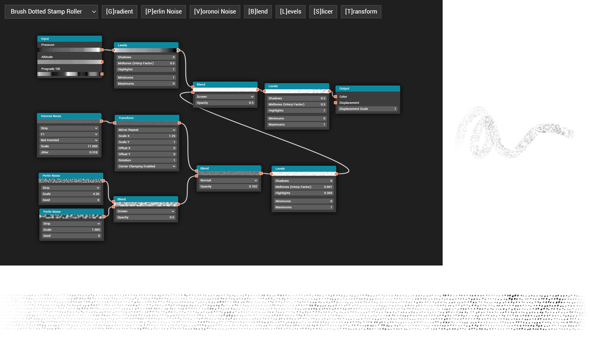
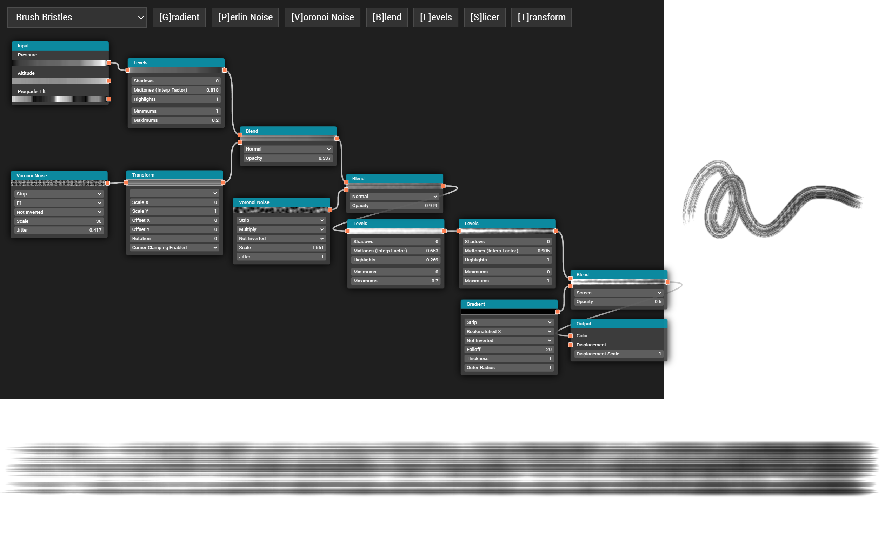
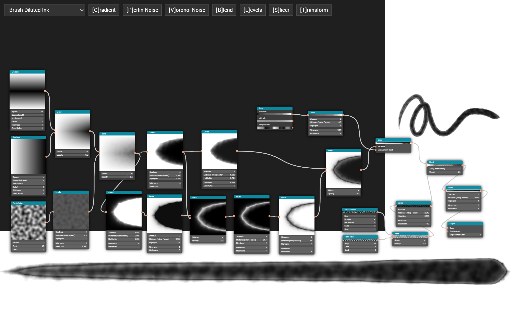
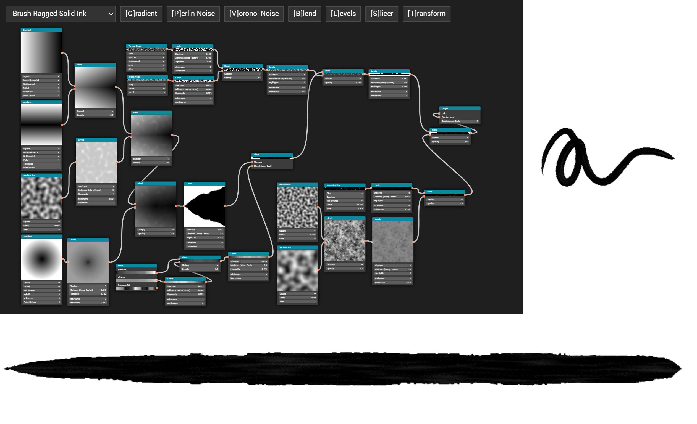
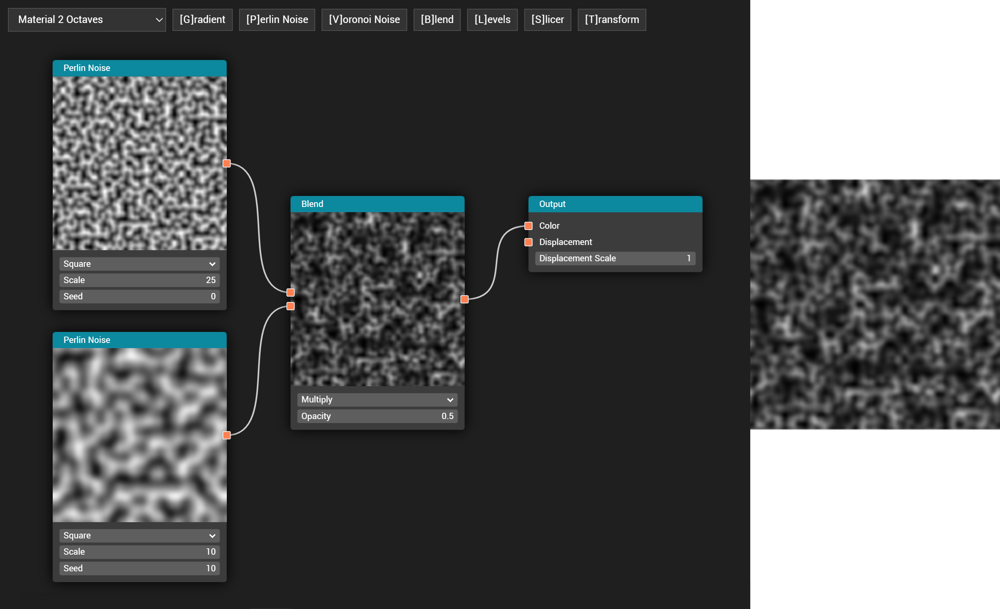
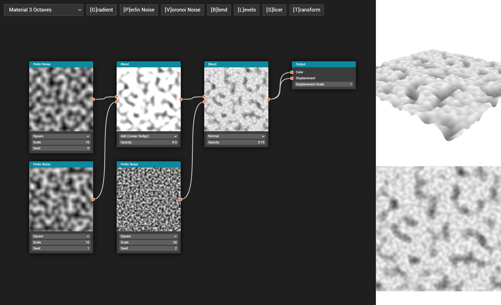
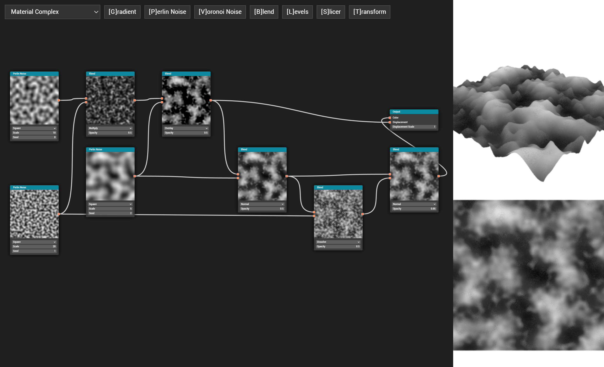

# Overview

**Brush Nodes** is a web-based prototype of a node-based procedural generator for dynamic stylus brushes and tileable materials. A graph is composed by wiring together pattern, math, and shaping nodes: Perlin Noise, Voronoi Noise, Gradient, Blend (normal, dissolve, multiply, screen, add, overlay, and subtract modes), Levels, Transform, and Slicer, plus Input and Output endpoints.

The Input node exposes recorded stylus data (pressure, tilt, and prograde direction) that a graph can sample to produce a stroke profile that reacts to the drawing dynamics of a real pen. Outputs are previewed two ways depending on the form factor of the result: a square material is shown on a spinning displaced plane with base color and height, while a strip-shaped brush stroke is shown sweeping along a curving path.

The node graph itself is built in the DOM with HTML and CSS, while every node's compositing operation, the preview thumbnails, and the final 2D and 3D outputs are implemented in WebGL with custom GLSL shaders.

# Thesis

The procedural brush generation framework is a proof of concept for my [master's thesis](https://github.com/keavon/thesis):  
[*Artist-Configurable Node-Based Approach to Generate Procedural Brush Stroke Textures for Digital Painting*](https://digitalcommons.calpoly.edu/theses/2653/)

**Abstract:**

Digital painting is the field of software designed to provide artists a virtual medium to emulate the experience and results of physical drawing. Several hardware and software components come together to form a whole workflow, ranging from the physical input devices, to the stroking process, to the texture content authorship. This thesis explores an artist-friendly approach to synthesize the textures that give life to digital brush strokes.

Most painting software provides a limited library of predefined brush textures. They aim to offer styles approximating physical media like paintbrushes, pencils, markers, and airbrushes. Often these are static bitmap textures that are stamped onto the canvas at repeating intervals, causing discernible repetition artifacts. When more variety is desired, artists often download commercially available brush packs that expand the library of styles. However, included and supplemental brush packs are not easily artist-customizable.

In recent years, a separate field of digital art tooling has seen the popular growth of node-based procedural content generation. 3D models, shaders, and materials are commonly authored by artists using functions that can be linked together in a visual programming environment called a node graph. In this work, the feasibility is tested of using a node graph to procedurally generate highly customizable brush textures. The system synthesizes textures that adapt to parameters like pen pressure and stretch along the full length of each brush stroke instead of stamping repetitively. The result is a more flexible and artist-friendly way to define, share, and tweak brush textures used in digital painting.

# Usage and Demos

### [Brush Dotted Stamp Roller  ](https://keavon.github.io/Brush-Nodes/#brush-dotted-stamp-roller)
### [Brush Bristles  ](https://keavon.github.io/Brush-Nodes/#brush-bristles)
### [Brush Diluted Ink  ](https://keavon.github.io/Brush-Nodes/#brush-diluted-ink)
### [Brush Ragged Solid Ink  ](https://keavon.github.io/Brush-Nodes/#brush-ragged-solid-ink)
### [Material 2 Octaves  ](https://keavon.github.io/Brush-Nodes/#material-2-octaves)
### [Material 3 Octaves  ](https://keavon.github.io/Brush-Nodes/#material-3-octaves)
### [Material Complex  ](https://keavon.github.io/Brush-Nodes/#material-complex)
